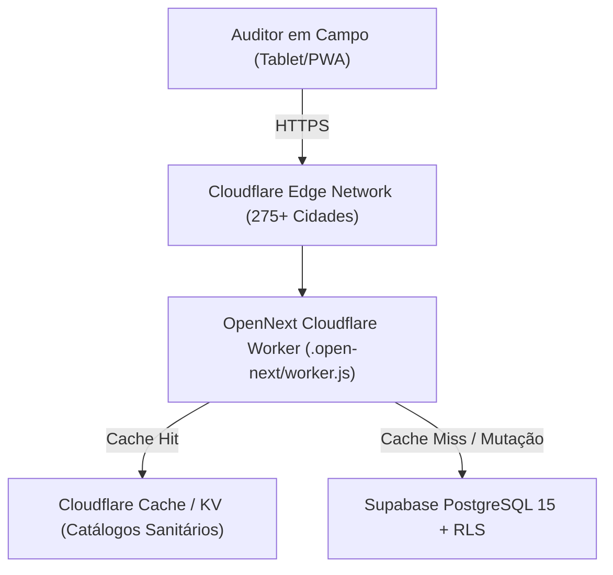

# ADR-001: Adoção do Cloudflare Workers & OpenNext para Edge Computing de Baixo Custo

**Status:** Aprovado  
**Data:** 2026-10-21  
**Decisores:** Enterprise Architect, DevOps Agent, Tech Lead  
**Contexto Técnico:** Next.js 15 App Router, Cloudflare Workers, `@opennextjs/cloudflare`, Wrangler  

---

## 1. Contexto e Problema

O **BioAudit Pro** é uma plataforma SaaS para auditorias de segurança alimentar e APPCC. A empresa requer uma infraestrutura de hospedagem de altíssimo desempenho, escalabilidade distribuída para auditores em campo na Europa e na América Latina, e **custo operacional inicial zero (Free Tier)**.

Modelos convencionais de hospedagem baseados em instâncias Node.js dedicadas (ex: AWS EC2, ECS ou contêineres Docker) exigem custo fixo mensal contínuo, manutenção de clusters e latência de rede regionalizada. Serviços de hospedagem serverless como Vercel possuem limitações severas de cota gratuita para projetos comerciais multi-tenant.

## 2. Decisão

Adotamos a execução do Next.js 15 sobre o **Cloudflare Workers** utilizando o adaptador oficial **OpenNext** (`@opennextjs/cloudflare`) e CLI `wrangler`.

## 3. Consequências e Trade-Offs

### Consequências Positivas:
- **Custo Operacional Zero:** O tier gratuito do Cloudflare Workers oferece 100.000 requisições/dia com CPU time generoso.
- **Latência Próxima de Zero:** Resolução de rotas e Server Components executados no PoP mais próximo do inspetor sanitário.
- **Sem Servidores para Gerenciar:** Deploy automatizado e atômico via `npm run deploy` (`wrangler deploy`).

### Trade-Offs e Restrições Mitigadas:
- **Runtime workerd (V8 Isolates):** O Cloudflare Workers não executa Node.js completo. Módulos que dependem de `fs` nativo ou `child_process` não podem ser usados em runtime.
  - *Mitigação:* Bibliotecas criptográficas utilizam a Web Crypto API nativa e `jose`.
- **Limite de CPU por Requisição:** Cálculos pesados em lote devem ser particionados.
  - *Mitigação:* O cálculo do laudo APPCC no `ComplianceCalculatorService` é O(N) puro sobre 30 pontos e executa em < 2ms.
