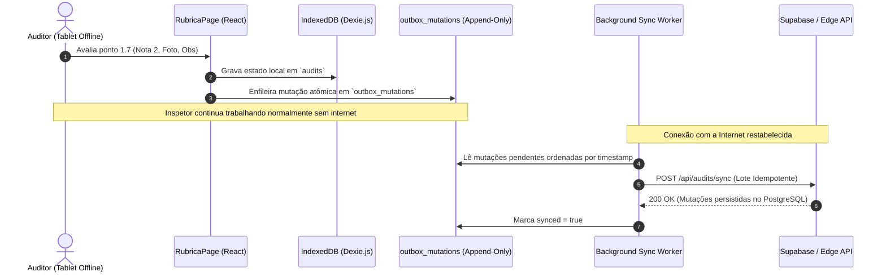

# ADR-002: Persistência Local PWA com Dexie.js (IndexedDB) e Outbox Pattern

**Status:** Aprovado  
**Data:** 2026-10-21  
**Decisores:** Enterprise Architect, Front-End Architect, QA Engineer  
**Contexto Técnico:** PWA Offline-First, Dexie.js 4, IndexedDB, Sincronização Resiliente a Migrations  

---

## 1. Contexto e Problema

Os auditores e veterinários oficiais frequentemente executam inspeções higiênico-sanitárias em locais sem sinal de internet (câmaras frigoríficas subterrâneas, matadouros industriais ou zonas rurais). O aplicativo **BioAudit Pro** deve funcionar 100% offline no PWA móvel.

O desafio crítico consiste em: **garantir que nenhuma auditoria, nota, foto ou assinatura seja perdida em campo, mesmo que novas migrações de banco ou atualizações de schema ocorram no backend enquanto o auditor está desconectado**.

## 2. Decisão

Rejeitamos SQLite WASM e PGLite (devido a incompatibilidades com Safari iOS, restrições de headers COOP/COEP e peso de bundle de 3 MB+) e decidimos manter o **Dexie.js (IndexedDB nativo)**, acoplado ao padrão arquitetural **Outbox Mutation Pattern (Fila Imutável de Eventos)**.

## 3. Consequências e Trade-Offs

### Consequências Positivas:
- **Compatibilidade 100% Mobile:** Suporte nativo e perfeito em Safari (iOS/iPadOS) e Chrome/Android.
- **Resiliência Total contra Migrations:** Mutações são gravadas como eventos brutos e imutáveis. Alterações em tabelas remotas não corrompem os dados locais da outbox.
- **Bundle Mínimo:** Dexie.js adiciona apenas ~20 KB gzipped, preservando a bateria dos dispositivos de campo.

### Mitigações:
- Imagens em Base64 de alta resolução são comprimidas no client antes do enfileiramento na outbox para não estourar a cota de storage local do navegador.
