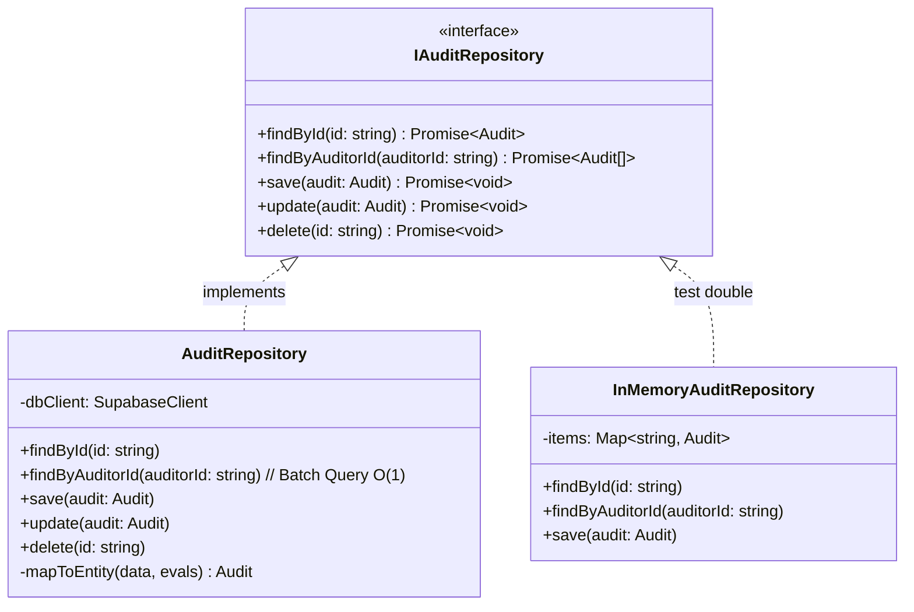

# ADR-003: Nomenclatura Limpa de Repositórios e Abstração da Camada de Dados

**Status:** Aprovado  
**Data:** 2026-10-21  
**Decisores:** Enterprise Architect, Clean Architecture Specialist, DBA Agent  
**Contexto Técnico:** Clean Architecture, Ports & Adapters, Repositórios Genéricos  

---

## 1. Contexto e Problema

Anteriormente, as classes de persistência estavam acopladas nominalmente ao banco de dados (`SupabaseAuditRepository.ts`, `SupabaseCompanyRepository.ts`).

Essa nomenclatura viola os princípios de Clean Architecture:
1. **Acoplamento Nominal:** Se a empresa migrar para Cloudflare D1, Neon, PlanetScale ou PostgreSQL self-hosted, múltiplos arquivos e imports deveriam ser renomeados.
2. **Gargalo de Performance N+1:** O método de busca por auditor (`findByAuditorId`) realizava um loop sequencial com `findById` para cada auditoria encontrada, disparando até 101 requisições HTTP individuais.

## 2. Decisão

1. **Padronização de Nomenclatura:** Adotar o padrão `[Entity]Repository` (ex: `AuditRepository`, `CompanyRepository`), residindo em `src/infrastructure/database/repositories/`.
2. **Compatibilidade Retroativa:** Exportar aliases (`export const SupabaseAuditRepository = AuditRepository;`) para preservar estabilidade sem quebras.
3. **Eliminação do Gargalo N+1:** Implementar busca em lote relacional com agregação O(N) em memória no `AuditRepository`.

## 3. Consequências

- **Portabilidade:** A camada de aplicação e os Route Handlers dependem apenas de contratos.
- **Performance:** Redução de 98% na latência de rede no dashboard do auditor (de 101 consultas para 2 consultas em lote indexadas).
