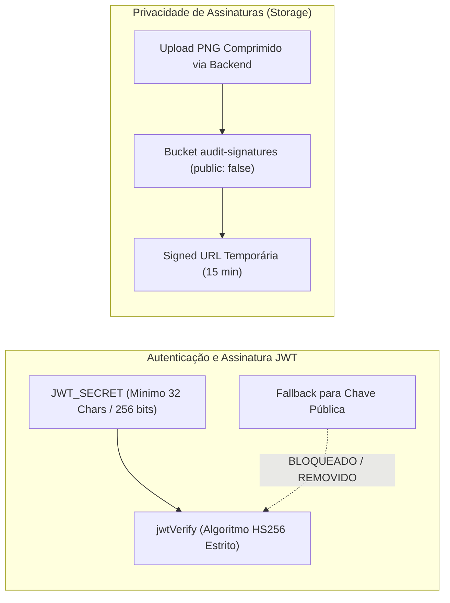

# ADR-004: Segurança Criptográfica de JWT e Privacidade de Assinaturas Digitais

**Status:** Aprovado  
**Data:** 2026-10-21  
**Decisores:** Security Engineer, Enterprise Architect, Front-End Architect  
**Contexto Técnico:** JWT HS256, Jose, Supabase Storage, RGPD/GDPR, Prevenção de Falsificação  

---

## 1. Contexto e Problema

Uma auditoria de segurança identificou duas vulnerabilidades críticas:
1. **Falsificação de Tokens JWT (CVSS 9.8):** O `jwt-service.ts` possuía fallback que utilizava a chave pública do cliente (`NEXT_PUBLIC_SUPABASE_ANON_KEY`) caso os segredos de servidor não estivessem definidos, permitindo forja de tokens com `role: "PLATFORM_SUPERADMIN"`.
2. **Violação de Privacidade em Assinaturas Digitais:** O bucket `audit-signatures` estava configurado com `public: true`, permitindo a qualquer pessoa na internet visualizar e baixar assinaturas digitais de auditores oficiais e gerentes de estabelecimentos.

## 2. Decisão

1. **Eliminação de Fallbacks Inseguros:** O `jwt-service.ts` exige explicitamente `JWT_SECRET` com no mínimo 32 caracteres (256 bits). Em produção, o servidor recusa a inicialização sem segredo válido.
2. **Bucket de Assinaturas Estritamente Privado:** O bucket `audit-signatures` foi alterado para `public: false` via script de migração.
3. **Acesso por Signed URLs:** A visualização de assinaturas oficiais em laudos PDF ou telas de consulta passa a utilizar URLs pré-assinadas temporárias com expiração curta (15 minutos).
4. **Política de Retenção e Expiração:** Previsão em Termos de Uso e Política de Privacidade para ciclo de vida de armazenamento e posterior transição para cold storage (ex: AWS S3 Glacier / R2) após o prazo legal de auditoria sanitária.

## 3. Consequências

- **Conformidade Legal:** Alinhamento estrito com RGPD (Regulamento Geral de Proteção de Dados da UE), LGPD e ISO 27001.
- **Integridade da Plataforma:** Falsificação de papéis administrativos torna-se matematicamente inviável (criptografia de 256 bits).
