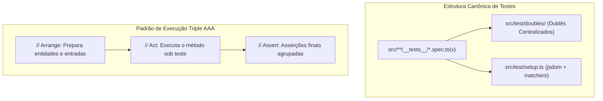

# ADR-005: Padrão de Engenharia de Testes, Eliminação de Tautologia e Triple AAA

**Status:** Aprovado  
**Data:** 2026-10-21  
**Decisores:** QA Engineer, Clean Architecture Specialist, Front-End Architect  
**Contexto Técnico:** Vitest, React Testing Library, Triple AAA, Dublês de Teste Isolados  

---

## 1. Contexto e Problema

A suíte de testes original apresentava problemas estruturais:
1. **Testes Tautológicos:** Testes que apenas verificavam se um dicionário estático em memória possuía a chave recém-declarada, sem testar invariantes ou comportamentos reais.
2. **Desorganização de Dublês:** Classes `InMemoryRepository` estavam soltas dentro de `application/use-cases/__tests__/`.
3. **Mistura de Idiomas:** Nomes de testes mesclavam espanhol e português em descritores e variáveis.
4. **Ausência de Testes de Componentes:** Inexistência de testes para verificar comportamento de UI e acessibilidade básica.
5. **Violação do Padrão Triple AAA:** Testes com múltiplos `Act` e `Assert` intercalados em loops.

## 2. Decisão

1. **Padrão de Idioma:** Código, descritores (`describe`, `it`), variáveis e helpers são 100% em **Inglês**. Textos de normas e domínio de negócio sanitário permanecem em Espanhol (normativa legal).
2. **Centralização de Dublês:** Dublês e repositórios em memória residem exclusivamente em `src/test/doubles/`.
3. **Padrão Triple AAA Estrito:** Todos os testes separam explicitamente as seções de Arrange, Act e Assert, mantendo os asserts exclusivamente no final.
4. **Testes de UI:** Adição de testes de componentes com `@testing-library/react` verificando renderização, acessibilidade e eventos de usuário.

## 3. Consequências

- **Manutenibilidade:** Testes legíveis, determinísticos e sem falsos positivos.
- **Zero Custo de Infraestrutura:** Testes executam 100% in-memory em menos de 3 segundos, sem depender de instâncias externas de banco de dados.
